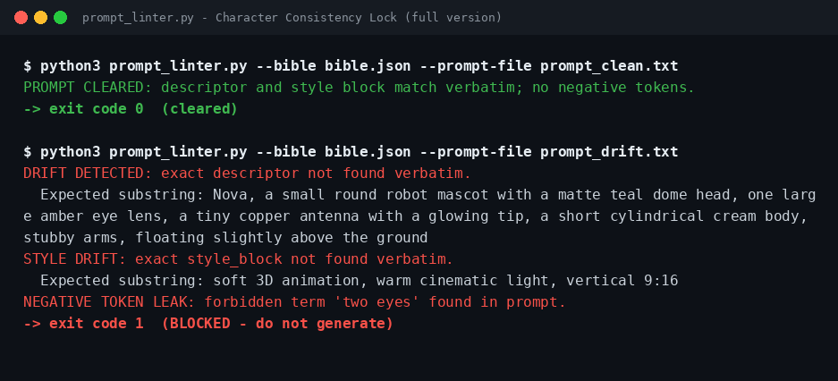

# Character Consistency Lock — Lite (Free)

**An AI agent skill for keeping one character identical across every AI-generated video scene.**

Built for faceless video pipelines (Veo / Google Flow, Kling, Runway, Flux, Midjourney) and for agents that run them — Claude Code, Cursor, and other SKILL.md / MCP-based agents.

## The problem

AI video generators have no memory of your character. Describe "the same puppy" in ten prompts and you get ten different puppies. In one real production test, a character drifted in **4 out of 4 scenes** because the tool only ever saw a text description — no locked reference, no verification step. The series was unusable.

## The method (4 steps)

1. **Character Bible** — one JSON file is the single source of truth: face tokens, colors *with placement*, signature items, proportions, negative tokens.
2. **Freeze** — a descriptor string and a style block are pasted **character-for-character** into every generation prompt. Never paraphrased, never "improved" by the agent.
3. **Anchors before motion** — approved anchor stills (front, three-quarter, side, full body) are generated and locked before any video clip is made.
4. **Drift audit** — every output is checked against the negative-drift checklist before it is allowed into the edit.

## What's in this free lite edition

- `negative-drift-checklist.md` — the pre-publish drift audit checklist (the audit from Step 4).
- `sample-character-bible.json` — a complete, filled Character Bible for a fictional mascot ("Nova"), ready to copy and adapt.
- `terminal-prompt-linter.png` — the full version's hard gate catching a drifted prompt in a real run:

## The full version (on Agensi)

The lite edition is the checklist and the format. The full **Character Consistency Lock for AI Video** adds the enforcement machinery:

- `prompt_linter.py` — a Python hard gate (exit 1) that blocks any prompt whose descriptor or style block is not verbatim, or that leaks a negative token.
- The complete Character Bible JSON schema.
- Anchor prompt templates for Veo/Flow, Kling, Runway and Flux/Midjourney.
- The multimodal drift-audit protocol (Step 2.5 + vision audit) and the version-bump rules.

→ **Full version: https://www.agensi.io/users/duylam** (store: Duy Lam)

It chains with the store's other video skills: Faceless Retention Director (pacing) → Character Consistency Lock → AI Video Budget Router (credits) → Reused-Content Shield (cross-channel reuse).

## Who made this

Distilled from running real faceless channels (an AI puppy-story channel, a stickman channel, a 3D science channel) where character drift and reused-content risk are daily operational problems, not theory.

## Keywords

claude-code-skill · cursor-rules · ai-video-consistency · mcp-skills · ai-agent-skills · faceless-youtube · character-consistency · veo · kling

## License

MIT — see `LICENSE`. The full version on Agensi is a separate commercial product.
